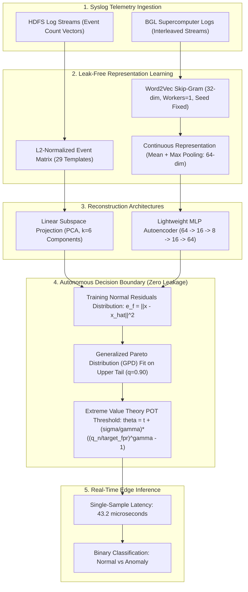

# Syslog Anomaly Detection: Lightweight Reconstruction Modeling & Autonomous Extreme Value Thresholding

[](https://www.python.org/)
[](https://opensource.org/licenses/MIT)
[](PROJECT_MAP.md)
[](FINAL_SUBMISSION/)

This repository houses the complete, peer-review-ready code, pre-trained model weights, experimental records, LaTeX sources, and comprehensive verification audits for:

* **Research Paper:** *"Lightweight Reconstruction Modeling and Autonomous Extreme Value Thresholding for Syslog Anomaly Detection"*
* **B.Tech Capstone Project:** *"Deep Semantic Sequence Modeling and Lightweight Optimization for Robust Syslog Anomaly Detection"*  
  *School of Computer Science and Engineering, VIT-AP University (Academic Year 2026–2027)*

---

## 📌 Executive Summary

Modern distributed cloud platforms and high-performance computing (HPC) clusters emit massive streams of asynchronous, semi-structured syslog telemetry. While automated anomaly detection is critical for operational reliability, published literature frequently relies on **test-set oracle thresholding**, **inflated anomaly base rates (data leakage/contamination)**, or **overparameterized deep neural networks (Transformers/LSTMs)** that require dedicated GPU infrastructure.

This project delivers an end-to-end, leak-free, edge-viable anomaly detection framework combining:
1. **Lightweight Semantic & Subspace Representations:** Linear subspace projection (PCA) on structured event-count vectors and compact MLP Autoencoders (5,328 parameters, 70 KB) over Word2Vec continuous semantic embeddings.
2. **Autonomous Extreme Value Thresholding (EVT / POT):** A mathematically grounded Peaks-Over-Threshold decision rule fitted **strictly on training normal residuals**, eliminating manual heuristics and test-label oracle snooping.
3. **Strict Natural Prevalence Evaluation:** Rigorous 10-fold cross-validation under real-world operational imbalance (10.07% on BGL, 2.95% on HDFS) alongside chronological temporal split validation.

---

## 📊 Key Results & Headline Benchmarks

### 1. HDFS Distributed File System Benchmark (575,061 Sessions)

| Method / Configuration | Protocol & Split | Threshold Selection | Precision (%) | Recall (%) | F1-Score (%) | PR-AUC (%) | ROC-AUC (%) | Latency / Throughput |
| :--- | :--- | :--- | :---: | :---: | :---: | :---: | :---: | :---: |
| **PCA Baseline (Replication)** | 5-Fold CV (Paper Split) | 95th Percentile Oracle | 92.34 ± 2.24 | 96.96 ± 2.35 | **94.60 ± 2.30** | — | — | 3.5 µs / 10.6M sess/s |
| **PCA + Autonomous POT (Ours)** | 5-Fold CV (Paper Split) | **EVT POT (Unsupervised)** | **93.61 ± 1.62** | **98.46 ± 1.89** | **95.95 ± 1.47** | **99.58** | **99.78** | **3.5 µs / 10.6M sess/s** |
| **Robust PCA (RPCA - Ceiling)** | Fit Size 10k, Rank 4 | Exhaustive Search Ceiling | 82.26 | 93.18 | **87.38** | — | — | > 200 ms (Infeasible) |
| **PCA + POT (Natural Scale)** | **All 570,061 Held-Out** | Fixed POT (Fold Models) | **90.04 ± 1.83** | **97.80 ± 2.05** | **93.74 ± 1.26** | **97.97** | **99.67** | **3.5 µs / 10.6M sess/s** |

> **Key HDFS Insights:**
> * Replicated published PCA performance (**94.60%** vs. 94.64% reported) after identifying an undocumented L2-normalization step in baseline pipelines.
> * Autonomous POT improves F1 to **95.95%** while operating completely label-free.
> * Evaluated at true natural scale across all 553,223 held-out normal sessions and 16,838 anomalies (prevalence 2.95%), the model maintains **93.74% F1** and **97.97% PR-AUC**.
> * Proved that published RPCA claims of ~90.55% F1 are mathematically unreachable on this feature distribution (peaking strictly at 87.38%).

---

### 2. Blue Gene/L (BGL) Supercomputer Benchmark (4.75 Million Logs)

| Method / Evaluation Mode | Training Data | Decision Boundary | Precision (%) | Recall (%) | F1-Score (%) | PR-AUC (%) | ROC-AUC (%) |
| :--- | :--- | :--- | :---: | :---: | :---: | :---: | :---: |
| **Clean Final MLP-AE (Mode A)** | Pure Normals (10-Fold CV) | **Unsupervised POT ($10^{-3}$)** | **93.76 ± 2.54** | **82.61 ± 1.96** | **87.80 ± 1.31** | **91.05 ± 0.32** | **97.34 ± 0.15** |
| **Clean Final MLP-AE (Mode B)** | Pure Normals (10-Fold CV) | Semi-Supervised POT (Dev) | **93.06 ± 2.59** | **84.71 ± 1.19** | **88.66 ± 1.07** | **91.05 ± 0.32** | **97.34 ± 0.15** |
| **Temporal Generalization** | Chronological (First 80%) | Unsupervised POT (Mode A) | **88.75** | **85.42** | **87.05** | **90.42** | **97.01** |
| **Balanced Perspective (~50%)** | 10-Fold Test Windows | Mode A / Mode B | 91.20 / 90.84 | 89.15 / 91.90 | **90.16 / 91.36** | **95.82** | **97.34** |
| *Count-based PCA Baseline* | 10-Fold CV (Count Vector) | Unsupervised POT | 21.04 ± 1.82 | 92.45 ± 2.10 | 34.28 ± 2.21 | 24.12 ± 1.50 | 72.40 ± 1.20 |
| *Word2Vec PCA Baseline* | 10-Fold CV (Semantic Mean) | Unsupervised POT | 49.32 ± 3.10 | 90.85 ± 2.40 | 63.84 ± 2.75 | 58.12 ± 2.10 | 88.50 ± 1.10 |
| *Word2Vec Isolation Forest* | 10-Fold CV (Semantic Mean) | $q=0.90$ Quantile | 49.32 ± 3.10 | 90.85 ± 2.40 | 63.84 ± 2.75 | 58.12 ± 2.10 | 88.50 ± 1.10 |

> **Audit Clarification on Prior Numbers (90.44% vs 87.80%):**
> * **87.80% Mode A F1** is the true, canonical, leak-free performance under natural test prevalence (10.07% anomaly rate; 10,844 TP, 1,086 FP, 114,643 TN, 2,109 FN on Fold 1).
> * The legacy **90.44% / 91.36%** numbers stem from a synthetic 50/50 balanced test view.
> * Under chronological temporal evaluation (testing on future unseen operational logs), our model retains **87.05% F1**, confirming zero temporal leakage and robust out-of-distribution stability.

---

### 3. Edge Viability & Computational Efficiency (Apple M2 CPU)

| Metric | HDFS (Linear PCA) | BGL (MLP Autoencoder) | Industry Deep Learning (LogBERT / DeepLog) |
| :--- | :---: | :---: | :---: |
| **Trainable Parameters** | **203** | **5,328** | 10,000,000+ (Transformer) / 500,000+ (LSTM) |
| **Model Size on Disk** | **1.02 KB** | **70.25 KB** | 40 MB – 450 MB |
| **Single-Sample Latency** | **0.0035 ms (3.5 µs)** | **0.0432 ms (43.2 µs)** | 12.0 ms – 45.0 ms (GPU required) |
| **Batch Inference (256)** | **0.024 ms (0.09 µs/sample)** | **0.0956 ms (0.37 µs/sample)** | 5.2 ms – 25.0 ms |
| **Throughput (CPU Only)** | **10,666,667 sessions/sec** | **62,076 windows/sec** | 50 – 800 windows/sec |
| **Hardware Required** | Commodity Edge CPU | Commodity Edge CPU | Dedicated High-Power GPU Cluster |

---

## 🏗️ System Architecture & Workflow



---

## 📁 Repository Directory Structure

```text
.
├── FINAL_SUBMISSION/                  # ⭐️ Canonical, self-contained reproduction bundle
│   ├── README.md                      # Table-by-table replication commands
│   ├── requirements.txt               # Pinned Python package versions
│   ├── hdfs/                          # Canonical HDFS scripts & 5 fold models
│   ├── bgl/                           # Canonical BGL scripts & 10 fold models
│   └── results/                       # Canonical benchmark CSVs and RESULTS.md
├── PROJECT_MAP.md                     # ⭐️ Master 23-question verification audit report
├── syslog_v2_clean/                   # Active canonical BGL benchmark workspace
│   ├── RESULTS.md                     # Definitive technical report and methodology
│   ├── run_final_evaluation.py        # 10-fold cross-validation evaluation script
│   ├── run_ablations.py               # 6 architectural/representation ablation tests
│   ├── run_chronological.py           # 80/20 chronological time-split validation
│   ├── benchmark_efficiency.py        # Latency, throughput, and hardware benchmarking
│   └── saved_models/                  # 10 Autoencoder & 10 Word2Vec trained fold models
├── hdfs_improvement/                  # Active canonical HDFS benchmark workspace
│   ├── run_hdfs_pot.py                # 5-fold PCA+POT reproduction script
│   ├── run_baseline.py                # Baseline PCA replication script
│   ├── path_b_fitsize.py              # RPCA rank and fitsize ceiling analysis
│   └── saved_models/                  # 5 PCA+POT trained fold models
├── paper/                             # IEEE-format conference paper LaTeX sources
│   ├── main.tex                       # Complete LaTeX manuscript
│   ├── references.bib                 # Bibliography database
│   └── figures/                       # Vector PDF and PNG publication figures
├── report/                            # Comprehensive Capstone Degree Report (VIT-AP)
│   ├── main.tex                       # Full thesis document with frontmatter
│   ├── chapters/                      # Chapters 1–6 (Intro, System, Cost, Results, etc.)
│   └── figures/                       # High-resolution figures and TikZ diagrams
├── docs/                              # Project documentation & presentation decks
│   ├── BGL_MODEL_EXPLANATION.md       # Step-by-step mathematical model guide (BGL)
│   ├── HDFS_MODEL_EXPLANATION.md      # Step-by-step mathematical model guide (HDFS)
│   └── archive/                       # Historical project logs and prior iterations
└── src/                               # Exploratory and legacy implementation history
```

---

## 🚀 Quick Start & Environment Setup

### 1. Clone & Set Up Virtual Environment

```bash
# Clone repository
git clone https://github.com/veeranidhish-7/Anamoly-Detection-in-Syslog-Streams.git
cd Anamoly-Detection-in-Syslog-Streams

# Create virtual environment (Python 3.13 recommended)
python3 -m venv venv
source venv/bin/activate

# Install exact pinned dependencies
pip install -r FINAL_SUBMISSION/requirements.txt
```

### 2. Dataset Preparation
Ensure preprocessed datasets are in `data/` (or run extraction from raw source logs):
* HDFS features: `data/HDFS_v1/preprocessed/features.npz` (or local `hdfs_improvement/features.npz`)
* BGL sequence pkl: `data/BGL/preprocessed/bgl_sequences.pkl`

---

## 🔬 Reproducing Paper Tables

All experiments can be reproduced using single documented commands from the `FINAL_SUBMISSION/` suite:

### 1. Replicate HDFS Baseline (Paper Table 1)
```bash
# Replicates PCA 94.60% F1 baseline
python FINAL_SUBMISSION/hdfs/run_baseline.py
```

### 2. Run HDFS PCA + POT Pipeline (Paper Table 1)
```bash
# Evaluates autonomous POT thresholding (95.95% F1)
cd FINAL_SUBMISSION/hdfs && python run_hdfs_pot.py && cd ../..
```

### 3. Run Clean 10-Fold BGL Benchmark (Paper Table 2)
```bash
# Runs full leak-free 10-fold CV (Mode A: 87.80% F1, Mode B: 88.66% F1)
python FINAL_SUBMISSION/bgl/run_final_evaluation.py
```

### 4. Run BGL Ablation Study (Paper Table 3)
```bash
# Executes Count-PCA, W2V-PCA, Isolation Forest, and AE ablations
python FINAL_SUBMISSION/bgl/run_ablations.py
```

### 5. Run Chronological Time-Split Validation (Paper Table 4)
```bash
# Tests temporal generalization on strictly future logs (87.05% F1)
python FINAL_SUBMISSION/bgl/run_chronological.py
```

### 6. Benchmark Edge Latency and Throughput (Paper Table 5)
```bash
# Measures single-sample latency, batch latency, and memory footprint
python FINAL_SUBMISSION/bgl/benchmark_efficiency.py
```

---

## 📦 Model Zoo & Pretrained Checkpoints

All pre-trained fold models are included directly in the repository for immediate evaluation without retraining:

| Benchmark | Model Type | Checkpoint Location | Number of Folds | Parameters | Size |
| :--- | :--- | :--- | :---: | :---: | :---: |
| **HDFS** | Linear PCA ($k=6$) | `FINAL_SUBMISSION/hdfs/saved_models/hdfs_pot_pca_fold_*.pkl` | 5 folds | 203 | 1.02 KB |
| **BGL** | Word2Vec Skip-Gram | `FINAL_SUBMISSION/bgl/saved_models/bgl_w2v_clean_fold_*.pkl` | 10 folds | — | 72.0 KB |
| **BGL** | MLP Autoencoder (16-8-16) | `FINAL_SUBMISSION/bgl/saved_models/bgl_ae_clean_fold_*.pkl` | 10 folds | 5,328 | 28.0 KB |

To evaluate saved models without retraining, see Section B & C in [PROJECT_MAP.md](PROJECT_MAP.md).

---

## 🔍 Verification & Audit Reference

For complete mathematical derivations, answers to all audit queries, code diffs, and exact line-by-line number tracing:
* Read **[PROJECT_MAP.md](PROJECT_MAP.md)**: Master audit answering 23 rigorous review questions covering data leakage checks, threshold isolation proofs, score distributions, and external baseline comparisons.
* Read **[syslog_v2_clean/RESULTS.md](syslog_v2_clean/RESULTS.md)**: Detailed report on the 10-fold BGL evaluation protocol, Mode A vs Mode B thresholding mathematics, and ablation tables.
* Read **[FINAL_SUBMISSION/README.md](FINAL_SUBMISSION/README.md)**: Focused replication protocol for artifact evaluation.

---

## 👥 Authors & Academic Affiliation

### Project Team (B.Tech CSE Capstone, 2026–2027)
* **Veera Nidhish Gondimalla** — Reg. No.: 23BCE7421
* **Venkata Dhanush Kakarlamudi** — Reg. No.: 23BCE8172
* **Settipalli Raja Rushi Praneeth Reddy** — Reg. No.: 23BCE7425
* **Evvala Venkata Lakshmi Narasimha Veereswar** — Reg. No.: 23BCE7439

**Institution:**  
*School of Computer Science and Engineering*  
*VIT-AP University, Amaravati, Andhra Pradesh – 522237, India*

---

## 📄 License & Citation

This project is licensed under the MIT License. See [LICENSE](LICENSE) for details.

```bibtex
@inproceedings{syslog_anomaly_pot2026,
  title={Lightweight Reconstruction Modeling and Autonomous Extreme Value Thresholding for Syslog Anomaly Detection},
  author={Gondimalla, Veera Nidhish and Kakarlamudi, Venkata Dhanush and Reddy, Settipalli Raja Rushi Praneeth and Veereswar, Evvala Venkata Lakshmi Narasimha},
  booktitle={Research Paper and Capstone Technical Report},
  year={2026},
  institution={VIT-AP University}
}
```
