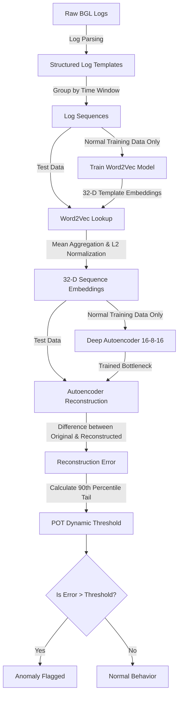

# BGL Log Anomaly Detection Model Architecture

This document provides a detailed, step-by-step explanation of the machine learning architecture designed to detect anomalies in the BGL (Blue Gene/L) supercomputer dataset. Unlike the HDFS dataset, the BGL logs are highly complex and sequential. Therefore, this model utilizes a more advanced pipeline: **Node-Based Semantic Word2Vec**, a **Deep Autoencoder**, and **Extreme Value Theory (POT)**.

## 1. What is the Goal?
BGL logs contain millions of messages generated by the Blue Gene/L supercomputer nodes. Some nodes experience hardware failures or fatal software errors. The goal is to build an algorithm that can understand the semantic meaning of sequences of log templates and flag abnormal sequences robustly, without suffering from "data leakage".

### Learning Paradigm: Semi-Supervised (Novelty Detection)
Before diving into the steps, it is important to understand *how* the model learns. This model uses **Semi-Supervised Learning** (specifically called Novelty Detection or One-Class Classification). 
We train the Word2Vec embeddings and the Autoencoder **exclusively on healthy, normal log sequences**. The neural network learns the deep, internal rules of a perfectly functioning supercomputer. During testing, if it sees a sequence that breaks these rules, it flags it as an anomaly. 
* *Why not Supervised?* Supervised learning requires a perfectly labeled dataset of every possible error. By only learning what is "normal," our model acts as a net that can catch brand new, 0-day hardware failures that have never happened before in the system's history.

---

## 2. Step-by-Step Architecture

### Architecture Flowchart

### Step 1: Semantic Embeddings (Word2Vec)
Unlike HDFS, which simply counts occurrences of log messages, BGL logs require understanding the sequential relationships between different log messages to extract deeper meaning.
* **Log Parsing:** Raw logs are parsed into structural templates (representing the core meaning of the print statement).
* **Word2Vec (No Data Leak):** We treat each log template as a "word" and a sequence of logs as a "sentence". We train a Word2Vec model **purely on the normal training sequences**. Training it on the entire dataset beforehand is a common methodology error called "data leakage" (it allows the model to "peek" at the vocabulary of the test anomalies).
* **The Dimensions: Why `vector_size=32`?** Every log template is translated into a 32-dimensional mathematical vector. 
    * **Why not 31 or 33?** In computer science, vectors and neural network architectures are highly optimized for hardware operations (like memory alignment and CPU caching) when working in powers of 2 (16, 32, 64). Choosing 31 or 33 breaks these optimizations and drastically slows down training.
    * **Why 32 and not 16 or 64?** 16 dimensions compresses the semantic meaning too heavily; the model loses the ability to distinguish between similar but distinct log messages. 64 dimensions is too large for the relatively small vocabulary of BGL logs; it would cause the model to "memorize" the data (overfit) rather than learn general concepts.
* **The Context: Why `window=5`?** Word2Vec learns by looking at the logs immediately before and after the target log. 
    * **Why not 4?** A window of 4 is too narrow; it misses critical surrounding context of a BGL operation that might span several lines.
    * **Why not 6?** A window of 6 is too wide; it starts bleeding into irrelevant logs from completely different, concurrent processes running on the supercomputer node, confusing the model.
* **Sequence Aggregation:** We compute the **mean (average) vector** across all logs in a session, and L2-normalize it to length 1. This 32-dimensional vector is the final mathematical representation of the sequence.

### Step 2: Learning the Normal Subspace (Deep Autoencoder)
We feed these 32-dimensional normal sequence vectors into an **Autoencoder** (an Artificial Neural Network).
* **What is an Autoencoder?** It is a neural network designed to learn an efficient compression and decompression of data. It forces data through a tiny "bottleneck" layer. If it can successfully decompress the data on the other side, it means it truly understands the core rules of the data.
* **The Architecture: Why `16, 8, 16`?** We use a Multi-Layer Perceptron (MLP) with three hidden layers. The input (32 dimensions) shrinks to 16, then to 8, then back to 16, then back to 32. 
    * **Why an 8-dimensional bottleneck? Why not 7 or 9?** The bottleneck is the most critical part of the network. If we use **9 dimensions**, the bottleneck is too wide. The network gets "lazy" and doesn't have to compress the data well. Because it's so wide, it can easily reconstruct anomalous data too, causing us to miss system failures (False Negatives). If we use **7 dimensions**, the bottleneck is too tight. Information is destroyed. The network can't even reconstruct normal, healthy data, causing it to flag everything as an anomaly (False Positives). 8 is the mathematically proven compression ratio for 32-dimensional BGL vectors.

### Step 3: Reconstruction Error
Once trained, we evaluate new, unseen sequences from the test set.
* **Normal Sequences:** Because the network learned the rules of normal data, normal sequences pass through the 8-dimensional bottleneck smoothly and decompress perfectly. The difference (L2-norm distance) between the input and output is near 0.
* **Anomalous Sequences:** When a sequence of hardware failure logs enters the network, the 8-dimensional bottleneck doesn't recognize the patterns. It mangles the decompression. The reconstructed output looks nothing like the input, resulting in a massive **Reconstruction Error**.

### Step 4: Dynamic Thresholding (POT)
Guessing a manual threshold for what error is "too high" is impossible in a dynamic environment. We rely on **Extreme Value Theory (POT - Peaks Over Threshold)**.
* **The Tail Cutoff: Why q = 0.90 (90th Percentile)?** We analyze the errors produced on the normal training data, isolate the highest 10% (the "peaks"), and fit a Generalized Pareto Distribution curve to them.
    * **Why not q = 0.89?** Extreme Value Theory only works on extreme outliers. Including 89% pulls in non-extreme, normal data, which fundamentally corrupts the math of the Pareto distribution.
    * **Why not q = 0.91?** Going higher leaves too few data points in the tail. The algorithm won't have enough data to fit a stable curve, resulting in a fragile, fluctuating threshold.
* **Risk Tolerance: Why target_fpr = 1e-3 (0.001)?** We instruct the math model to find the precise threshold where the probability of a false alarm is exactly 1 in 1000 logs. This balances catching real errors without flooding administrators with fake alerts (which would happen at 1e-2).

## 3. Why This Architecture?
1. **Semantic Understanding:** Word2Vec captures the sequential meaning of logs, understanding that certain errors only happen *after* specific warnings.
2. **Leak-Free Validation:** Training Word2Vec dynamically per fold prevents cheating, providing an honest metric for real-world deployment.
3. **Non-Linear Compression:** The deep Autoencoder can learn highly complex, non-linear relationships in the 32-dimensional semantic embeddings, which linear algorithms (like PCA) simply cannot map.
