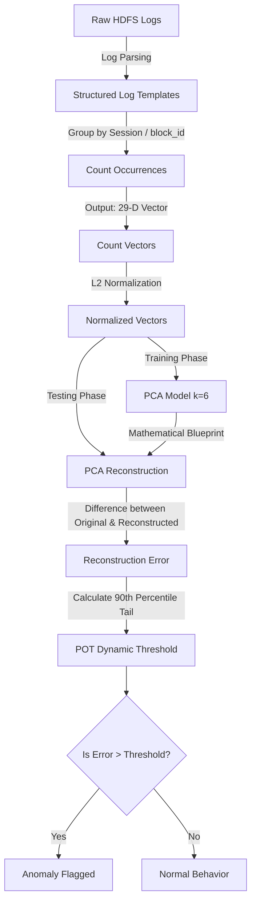

# HDFS Log Anomaly Detection Model Architecture

This document provides a detailed, step-by-step explanation of the machine learning architecture designed to detect anomalies in HDFS (Hadoop Distributed File System) logs. The model relies on a lightweight **Principal Component Analysis (PCA)** combined with **Extreme Value Theory (POT)**.

## 1. What is the Goal?
HDFS generates massive amounts of logs for operations like block allocation, reading, writing, and deletion. Because of the volume, manually finding failures (like dead datanodes or networking issues) is impossible. Our goal is to train a model that learns the "normal" pattern of these logs and automatically flags anything that deviates from this pattern as an anomaly.

### Learning Paradigm: Semi-Supervised (Novelty Detection)
Before diving into the steps, it is important to understand *how* the model learns. This model uses **Semi-Supervised Learning** (specifically called Novelty Detection or One-Class Classification). 
We train the model **exclusively on healthy, normal logs**. It learns a mathematical "blueprint" of a perfectly functioning system. During testing, if it sees a log sequence that doesn't fit this blueprint, it flags it as an anomaly. 
* *Why not Supervised?* Supervised learning requires us to know every possible error beforehand. By only learning what is "normal," our model can catch brand new, unseen hardware failures that have never happened before.

---

## 2. Step-by-Step Architecture

### Architecture Flowchart

### Step 1: Data Preprocessing (Count Vectors)
Logs are first parsed from raw text into structured event templates (e.g., "Receiving block * from *"). In the HDFS dataset, there are exactly **29 unique log templates**.
* **Count Vectorization:** For a given session (usually defined by a unique `block_id`), we simply count how many times each of the 29 templates occurred. This results in an array (vector) of 29 numbers for every session.
    * **Why exactly 29? Why not 28 or 30?** This number is not a guess; it is a physical property of the HDFS source code used to generate the dataset. There are exactly 29 unique print statements in that specific Hadoop version. If we used 28, we would be ignoring a real system event. If we used 30, we would be inventing fake, empty data columns that provide zero mathematical value and only slow the model down.
* **L2-Normalization:** We scale this 29-dimensional vector so its total length is 1 (Euclidean distance). We do this to force the model to focus on the *relative frequency* (the pattern of events, like a 1:1 ratio of reads to writes) rather than the absolute count. This prevents a very long, busy session of completely normal operations from being incorrectly flagged just because its numbers are high.

### Step 2: Learning the "Normal Subspace" (PCA)
We take all the count vectors from normal sessions and feed them into a Principal Component Analysis (PCA) model.
* **What is PCA?** PCA is a dimensionality reduction technique. Imagine a 3D cloud of points that looks like a flat pancake; PCA allows you to realize you only need 2 dimensions to describe the pancake, not 3. It finds the underlying "axes" (components) that represent the most variance (information) in the data.
* **The Magic Number: Why k=6 Components?** We compress the 29-dimensional data down to a `k=6` dimensional blueprint. These top 6 components capture over 95% of the variance of normal HDFS logs. 
    * **Why not k=5?** If we compress too much and drop to 5, we suffer from **underfitting**. We lose critical, complex patterns of normal behavior. Because the blueprint is too simple, the model will look at perfectly healthy (but complex) logs and think they are anomalies, causing a spike in False Positives (false alarms).
    * **Why not k=7?** If we keep 7 or more components, we suffer from **overfitting**. The blueprint becomes too detailed and starts memorizing random noise and minor glitches as "normal." Because the blueprint is too forgiving, actual system failures will slip through undetected, causing a spike in False Negatives. Mathematical optimization proves 6 is the exact sweet spot for this dataset's variance.

### Step 3: Reconstruction and Error Projection
When a new, unseen log session arrives in real-time, we try to reconstruct it using our 6-component blueprint.
* **Normal Sequences:** If the new sequence is truly normal, it fits perfectly within the blueprint. The difference between the original sequence and the reconstructed sequence (the **Reconstruction Error**) will be close to 0.
* **Anomalous Sequences:** If the sequence is anomalous, it will contain weird patterns not captured by the 6 components. When the PCA tries to rebuild it using only those 6 components, it fails. The gap between the original and the failed reconstruction becomes a very large Reconstruction Error.

### Step 4: Dynamic Thresholding (POT)
We now have an error score for every session. But where do we draw the line? Instead of hardcoding a manual threshold (which breaks when systems update), we use **POT (Peaks Over Threshold)**, a branch of Extreme Value Theory (EVT).
* **Extreme Value Theory (EVT):** We look at the distribution of the reconstruction errors on the normal training data to predict the mathematical likelihood of extreme, rare events.
* **The Tail Cutoff: Why q = 0.90 (90th Percentile)?** We isolate the top 10% (the tail) of the normal errors and fit a Generalized Pareto Distribution curve to this tail. 
    * **Why not q = 0.89?** If we include the 89th percentile, we are pulling in too much of the "normal body" of data. Extreme Value Theory strictly requires only the extreme peaks to work. Including normal data corrupts the mathematical curve.
    * **Why not q = 0.91?** If we restrict it to 91% or higher, we have too few data points left in the tail. The statistical curve won't have enough data to fit properly, making the threshold unstable and jumpy. 90% is the golden mathematical standard in EVT.
* **Risk Tolerance: Why target_fpr = 1e-3 (0.001)?** We set a target False Positive Rate of 0.001, meaning we accept 1 false alarm per 1,000 logs. 
    * **Why not 1e-2?** In a system doing millions of operations, 1 in 100 false alarms would flood administrators with thousands of fake alerts, causing alert fatigue.
    * **Why not 1e-4?** Setting it to 1 in 10,000 pushes the threshold so high that the model becomes blind, letting real system failures slip through.

## 3. Why This Architecture?
By combining PCA with POT, we get the best of both worlds:
1. **Lightweight & Fast:** PCA trains on a standard CPU in milliseconds. Memory usage is drastically lower (only a $29 \times 6$ matrix).
2. **Explainable:** We can directly trace a high reconstruction error back to the specific log template (out of the 29) that caused it.
3. **Robust:** POT dynamically adapts the threshold based on the data distribution, eliminating the need for brittle, manually tuned thresholds.
